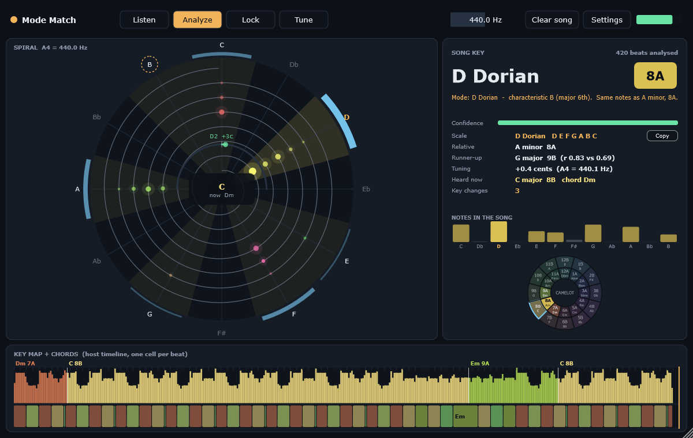

# Mode Match

Realtime pitch spiral + whole-song key (NuvoDeck's key detector, streaming) with modes and Camelot codes.
Design and decisions: [PLAN.md](PLAN.md).



Downloads: [Releases](https://github.com/agentr303/mode-match/releases). Windows: VST3, CLAP, standalone. macOS
(Apple Silicon + Intel): VST3, AU, CLAP, standalone.

## Features

- **Spiral**: one turn per octave; dots are the partials heard now (size = loudness, hue = note in circle-of-fifths
  order, brightness = stability, red halo = outside the song's scale). The song's scale is shaded; when the key heard
  now differs, its notes are ticked inside the rim. The centre shows the key and chord now and a +-50 cent drift ring.
  Settings: the note at the top and the range (full, piano, bass, treble...).
- **Song key**: key or mode (all seven), Camelot code, confidence, relative key, runner-up, tuning (cents and A4 in
  Hz), key changes, notes in the song, Camelot wheel. **Scale** names harmonic and melodic minor when the raised
  notes are played; **Copy** puts it on the clipboard for Melodyne / Auto-Tune ("A Harmonic Minor (A B C D E F G#)").
  A Camelot label in the host's track name ("8A 124 Bassline") is shown as a cross-check.
- **Key map + chords**: key and chord lanes over the host timeline (one cell per beat), with the playhead. Looping
  replaces what was there. Chords: major, minor, 7, diminished, sus4, smoothed by an HMM; the local key by a 24-state
  HMM. A percussion mask keeps drum hits out of the chord path.
- **Modes**: Listen, Analyze, Lock, Tune. **Tune**: click a note to set a target; the tuner shows cents from it and a
  zoomed 7-semitone ruler; names follow a transposing instrument (Bb, Eb, F).
- **ARA 2** (Studio One, Cubase, Logic, Reaper, Cakewalk): the clips' audio is analysed offline, without playing it.
- **MIDI out** (Settings, channel 1): a key switch (tonic note C1-B1, CC 20 = scale type 0 Major, 1 Natural Minor,
  2 Harmonic Minor, 3 Melodic Minor, 4 Dorian, 5 Phrygian, 6 Lydian, 7 Mixolydian, 8 Locrian) or the 7 scale notes
  held in C4-B4.
- **Presets** (host program list and Settings): Default, Baroque A415, Orchestra A442, Bb / Eb / F instrument, Bass.
- GPU drawing (OpenGL, can be turned off in Settings); the spiral engine sleeps while the editor is closed.

## Build

Needs CMake 3.24+ and a C++20 compiler. JUCE 9.0.1 is taken from `C:/Dev/NuvoDeck/build/_deps/juce-src` when it
exists, otherwise downloaded (or pass `-DFETCHCONTENT_SOURCE_DIR_JUCE=<path>`). The ARA SDK 2.3.0 and
clap-juce-extensions are downloaded too; `-DMM_ENABLE_ARA=OFF` / `-DMM_ENABLE_CLAP=OFF` leave them out.

### Windows (VST3 + CLAP + Standalone)

```
cmake -S . -B build
cmake --build build --config Release --target ModeMatch_VST3 ModeMatch_CLAP ModeMatch_Standalone
```

- VST3: `build/ModeMatch_artefacts/Release/VST3/Mode Match.vst3` - copy the whole `.vst3` folder to
  `C:\Program Files\Common Files\VST3\`.
- CLAP: `build/ModeMatch_artefacts/Release/CLAP/Mode Match.clap` - copy to `C:\Program Files\Common Files\CLAP\`.
- Standalone: `build/ModeMatch_artefacts/Release/Standalone/Mode Match.exe`

### macOS (AU + VST3 + CLAP + Standalone)

AU can only be built on a Mac. Same CMake:

```
cmake -S . -B build -DCMAKE_BUILD_TYPE=Release -DCMAKE_OSX_ARCHITECTURES="arm64;x86_64"
cmake --build build --config Release --target ModeMatch_AU ModeMatch_VST3 ModeMatch_CLAP ModeMatch_Standalone
```

Copy `Mode Match.component` to `~/Library/Audio/Plug-Ins/Components/` and check it with `auval -v aufx Mdm1 Mdmh`.

### CI and releases

- `.github/workflows/build.yml` (every push and pull request): builds all formats on Windows and macOS (universal),
  runs the tests, pluginval at strictness 10 (VST3; AU on macOS) and `auval`.
- `.github/workflows/release.yml` (when a release is published, or by hand with a tag): builds
  `ModeMatch-<version>-windows-x64.zip` and `ModeMatch-<version>-macos-universal.zip` and attaches them to the release.
  With the `MACOS_CERTIFICATE`, `MACOS_CERTIFICATE_PASSWORD`, `MACOS_SIGNING_IDENTITY`, `APPLE_ID`, `APPLE_TEAM_ID`
  and `APPLE_APP_PASSWORD` secrets set, the Mac builds are signed with your Developer ID and notarised; without them
  they are ad-hoc signed and users clear the quarantine flag (`xattr -dr com.apple.quarantine <bundle>`).

## Tests

```
cmake -S . -B build-tests -DMM_BUILD_PLUGIN=OFF
cmake --build build-tests --config Release --target ModeMatchTests
build-tests/ModeMatchTests_artefacts/Release/ModeMatchTests
```

Covers: NuvoDeck's 240-loop key test against both the copied `KeyDetector` and the streaming port (must agree), long
audio across 30 s blocks, loops replacing (not double counting) the timeline map, stopped transport, state round trip
(and loading 0.1.0 maps), 7 modes x 12 tonics, no false modes on major/minor material, Camelot codes, spiral peak and
YIN accuracy in every window, chord qualities, the local-key HMM on a modulation, the percussion mask under noise
bursts, bar positions from the host, phrase evidence for the tonic, and harmonic minor.
Also: a minor key whose root is only in the bass (under KeyDetector's 100 Hz band) is shown by its bass/chord tonic,
and real recordings listed in `BassTonicTests` are checked when the file is in the project folder and `ffmpeg` is on
PATH (skipped otherwise; the songs are not shipped).

`ModeMatchTests --analyze <audio file>` prints the analysis of one recording (shown key, profile match, mode-stage
tonic scores, chroma, bass and chord roots); it decodes with `ffmpeg`.

`python tools/giantsteps_benchmark.py <giantsteps-key-dataset dir>` scores the shown key on the GiantSteps Key
dataset (604 EDM previews) with the MIREX weighted score, next to NuvoDeck's profile match. The script's header says
how to download the dataset.

`ModeMatchRender <dir>` (target `ModeMatchRender`, in the plugin build) runs the real processor and editor on
synthesised music and writes PNGs of the Analyze, Tune and compact layouts.

## Name

The product was renamed from "Radial Key" (trademark risk - see PLAN.md section 9); "Mode Match" has been cleared. To
rename again, change `MM_PRODUCT_NAME`, `MM_COMPANY_NAME`, `BUNDLE_ID` and the plugin codes (`Mdmh` / `Mdm1`) in
`CMakeLists.txt`, and the CLAP id in the same file.

## Licence

Copyright (C) 2026 agentr303.

Mode Match is free software under the [GNU Affero General Public License v3.0](LICENSE). Contributions are
welcome under the terms in [CONTRIBUTING.md](CONTRIBUTING.md).

Third-party code, research sources and trademarks: [THIRD_PARTY_NOTICES.md](THIRD_PARTY_NOTICES.md).
